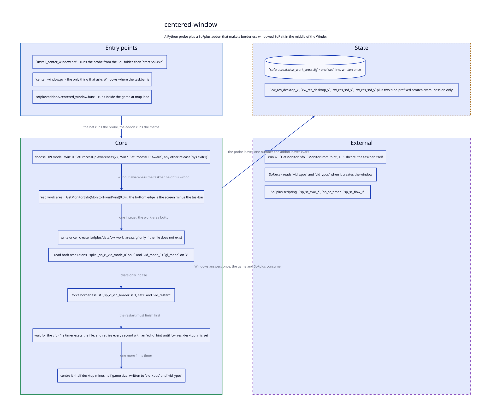

# centered-window

A Python probe and a SoFplus addon that between them place a borderless, windowed Soldier of Fortune window in the middle of the Windows work area instead of wherever it lands by default.

Read it left to right:

- **Two languages, one number between them.** `center_window.py` asks Windows for the work area and writes a single `set cw_res_desktop_y` line into `sofplus/data/cw_work_area.cfg`. The `.func` addon does all the arithmetic in-game, once per launch. Nothing else is shared, so there is no runtime dependency on Python while playing.
- **Python only contributes the Y edge.** `work_area[3]` is the screen bottom minus the taskbar; the X and the game's own size come from SoF's `_sp_cl_vid_mode_0` and `vid_mode_$gl_mode` cvars. That also means a monitor with a non-zero origin, or a taskbar on the side, cannot be expressed — `MonitorFromPoint((0,0))` is always the primary monitor and the maths assumes it starts at 0,0.
- **The probe writes exactly once.** The cfg is only created when missing, so moving the taskbar, changing resolution or switching monitors keeps the stale height until you delete `sofplus/data/cw_work_area.cfg` yourself. Until it exists, the addon retries every second and just echoes "Pls run center_window.py" into the console.
- **The addon also changes a cvar you did not ask about.** If `_sp_cl_vid_border` is 1 it sets it to 0 and calls `vid_restart` before centring, so a client that had a border loses it. The centring itself is one line of arithmetic — half desktop minus half game window — pushed into `vid_xpos` and `vid_ypos`.
- **Windows 7 and 10 only, by string match.** `platform.release()` picks `SetProcessDPIAware` on 7 and `SetProcessDpiAwareness(2)` on 10; anything else exits before writing the cfg, because without DPI awareness the measured taskbar height is wrong.

Diagram source: [`docs/system.d2`](docs/system.d2) · renderer: [`scripts/render-diagram.sh`](scripts/render-diagram.sh).
